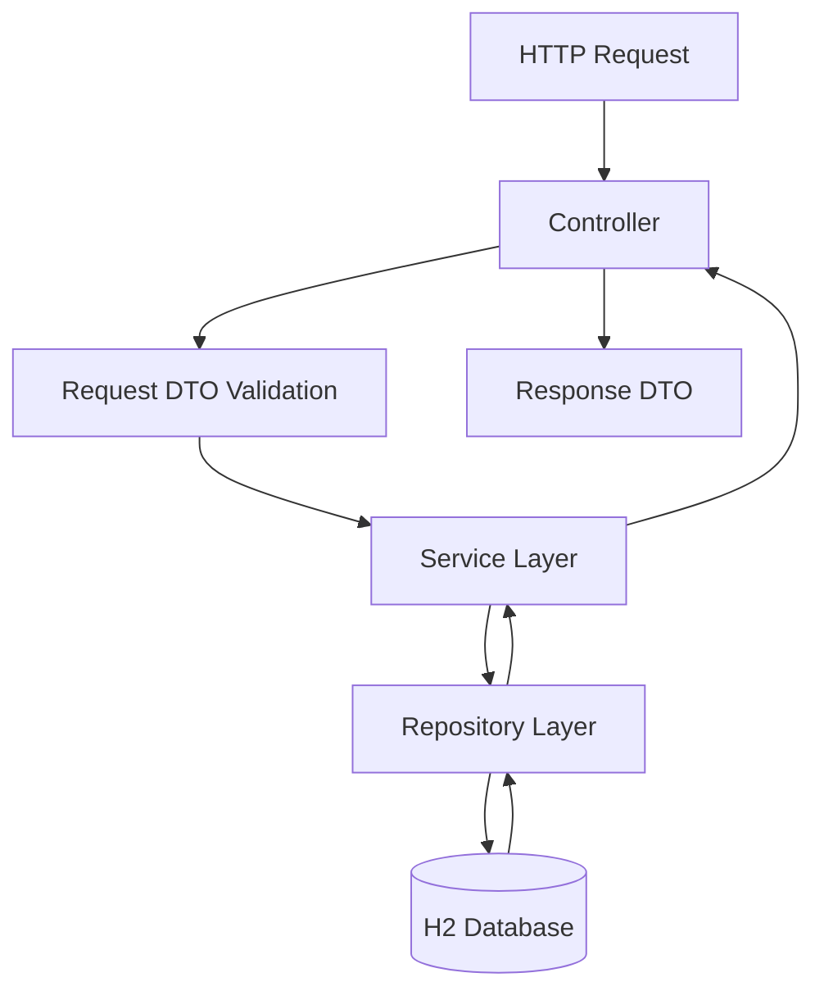
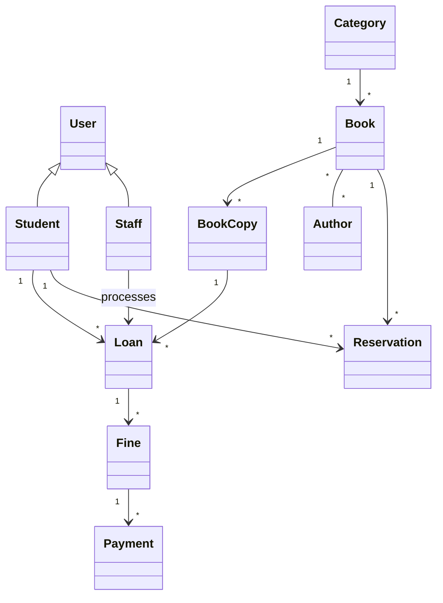

# Library System Backend

A REST API for managing a single-branch library, built with **Java and Spring Boot**. Students can browse books, request loans, reserve unavailable titles, and manage fines. Library staff manage books, loans, returns, and students, while administrators manage staff accounts.

> **Project status:** Early development. The data model, entities, DTOs, and basic application setup are in place. Most services, controllers, and security features are still being developed.

## Tech Stack


| Component | Technology |
|---|---|
| Language | Java 17+ |
| Framework | Spring Boot, Spring MVC |
| Persistence | Spring Data JPA, Hibernate |
| Database | H2 in-memory |
| Security | Spring Security (session-based login planned) |
| Validation | Jakarta Bean Validation |
| Utilities | Lombok |
| Build tool | Maven |

## Getting Started

### Prerequisites

- Java 17 or later
- Git (to clone the repository)

### Run the application

From the project root, run:

```bash
cd app
./mvnw spring-boot:run
```

On Windows, use:

```bat
mvnw.cmd spring-boot:run
```

Once started, the application is available at:

- **Home page:** http://localhost:8080
- **H2 Console:** http://localhost:8080/h2-console

H2 connection settings:

| Setting | Value |
|---|---|
| JDBC URL | `jdbc:h2:mem:librarydb` |
| Username | `sa` |
| Password | Leave empty |

**Note:** The database is currently in-memory and uses `ddl-auto=create-drop`. All data is lost when the application restarts.

**Security note:** `SecurityConfig` currently permits all requests and disables CSRF for development. This configuration is temporary and will be replaced with proper authentication and authorization before the application is used in a real environment.

## Features and User Roles

| Role | Responsibilities |
|---|---|
| Student | Search books, check availability, request loans, make reservations, view loans and fines, and record fine payments |
| Staff | Manage books and copies, process loans and returns, manage fines, and register students |
| Admin | Perform staff operations and manage staff accounts |
| Scheduler | Process overdue loans, generate fines, and expire uncollected requests and reservations |

## Architecture

The application follows a layered architecture:



- **Controllers:** Handle HTTP requests and responses.
- **DTOs:** Define the data accepted and returned by the API.
- **Services:** Implement business rules and application logic.
- **Repositories:** Access and manage database records.
- **Entities:** Represent the database model.

Entities are not returned directly by controllers, and password hashes are excluded from DTOs. Student-specific endpoints use `/me` to identify the logged-in student.

### Package Structure

Located under `com.lib.app`:

```text
controller/   REST controllers
service/      Business logic
repository/   Database access
model/        JPA entities
DTOs/         Request and response objects
enums/        Status and role enums
security/     Security configuration
```

## Domain Model



Key design decisions:

- **Book vs. BookCopy:** A `Book` represents a title, while each `BookCopy` represents a physical copy with its own status and condition.
- **User inheritance:** `User` is an abstract base class for `Student` and `Staff`, using JPA `JOINED` inheritance.
- **Enums:** Statuses and roles are stored as strings in the database.

## Business Rules

- Students request loans before collecting books. Staff confirm collection, changing the loan status from `REQUESTED` to `ACTIVE`.
- Uncollected loan requests expire after their pickup deadline.
- Staff process returns and can mark copies as lost or damaged.
- Students with unpaid or partially paid fines cannot request new loans.
- Reservations are allowed only when no copy of a title is available.
- When a copy becomes available, the next waiting reservation can be converted into a loan request.
- Fine payments are simulated; no real payment gateway is connected.
- Loan periods, borrowing limits, and daily fine rates are configurable.

## Planned API

All endpoints will be under `/api`.

| Area | Main operations | Access |
|---|---|---|
| Authentication | Login, logout, current user | All users |
| Books | Search, view, create, update, delete | Viewing: logged-in users; management: staff |
| Copies | Add copies, update status | Staff |
| Loans | Request, view own loans, cancel | Students |
| Loans | View requests, confirm pickup, process returns, mark lost | Staff |
| Reservations | Create, view own reservations, cancel | Students |
| Reservations | View reservations | Staff |
| Fines | View own fines, record payment | Students |
| Fines | Issue and waive fines | Staff |
| Students | View own profile | Students |
| Students | Register, suspend, search | Staff |
| Staff | Manage staff accounts | Admin |

These endpoints describe the planned API; not all operations are implemented yet.

## Design Documents

The `design/` directory contains:

- `class_diagram.drawio` — Class diagram
- `models.txt` — Entities, fields, relationships, and enums
- `DTOs.txt` — DTO definitions and fields

## Development Progress

### Completed

- [x] Requirements, user roles, and business rules
- [x] Class diagram and DTO design
- [x] Entity classes, relationships, and constraints
- [x] Enums
- [x] DTO classes
- [x] Landing page
- [x] H2 and JPA configuration
- [x] `UserRepository`

### In Progress

- [ ] Authentication and session management

### Planned

- [ ] Complete login, logout, and current-user endpoints
- [ ] Configure password encoding and authentication error responses
- [ ] Implement global exception handling and `ErrorResponse`
- [ ] Create the remaining repositories
- [ ] Implement services and controllers
- [ ] Add role-based access control
- [ ] Implement scheduled tasks for overdue loans, fines, and expirations
- [ ] Seed the first administrator account
- [ ] Build the login page
- [ ] Add automated tests
- [ ] Replace H2 with a persistent database

---

*This project is under active development. Features and API endpoints may change as implementation progresses.*
